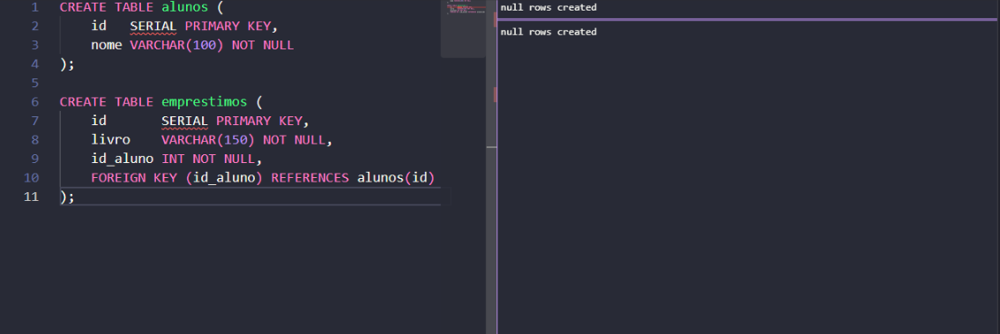
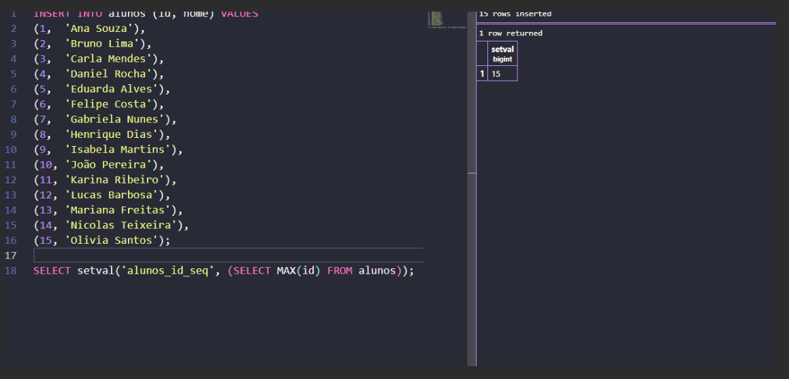
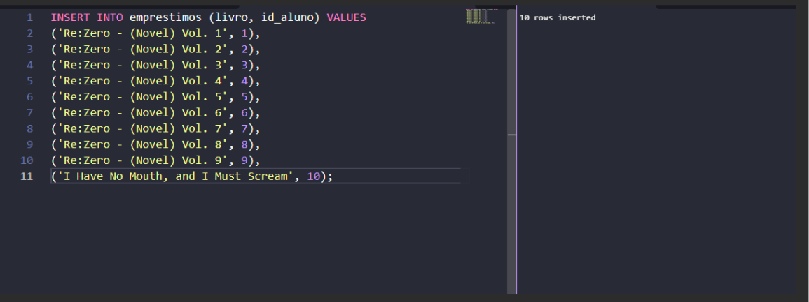
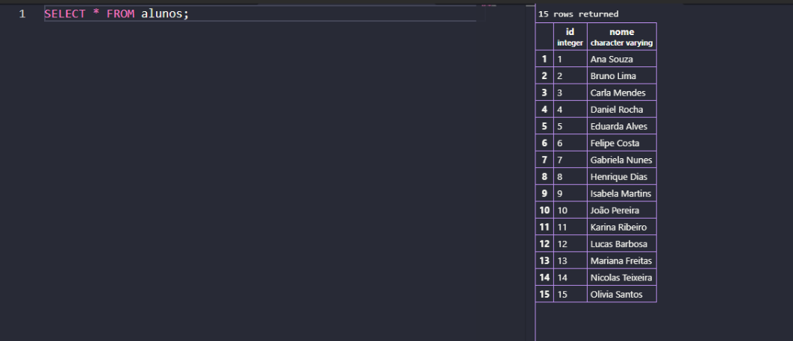
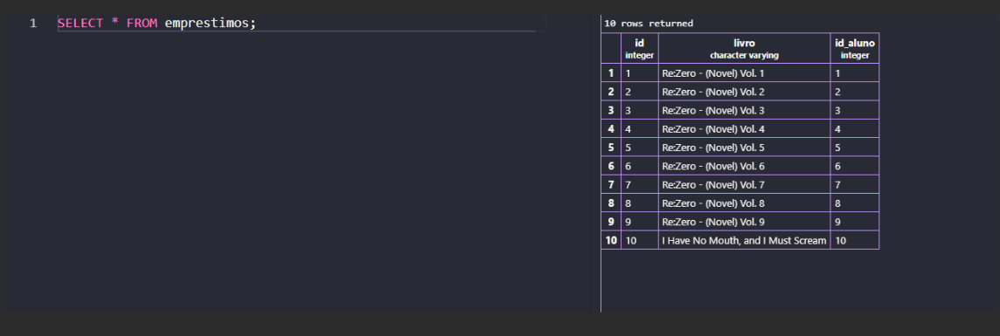
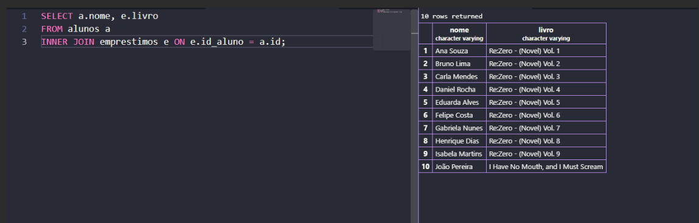
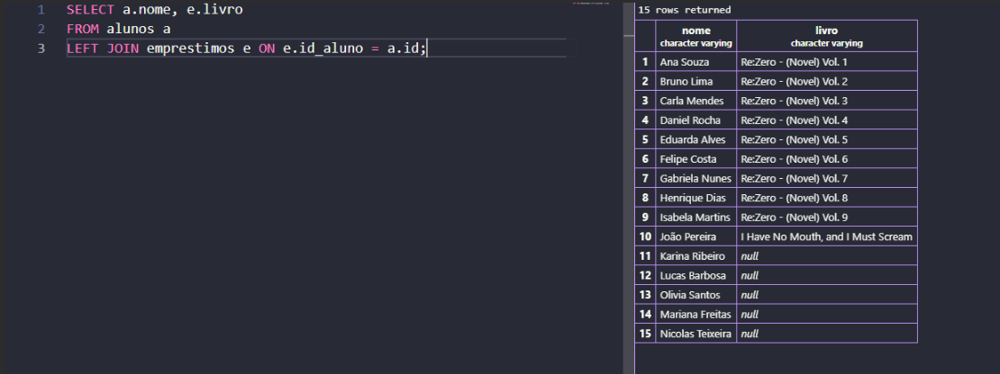
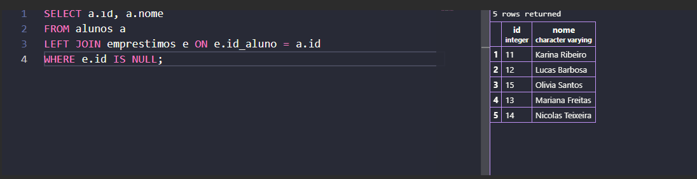
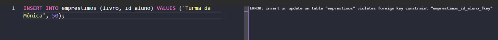

# Anotações – JOIN na Biblioteca

## O que foi feito

Criei um banco de dados para a bibliotecaSenai da escola com duas tabelas:

- `alunos` (id, nome): quem pega livros emprestados
- `emprestimos` (id, livro, id_aluno): qual livro foi emprestado e para qual aluno

O empréstimo guarda só o número do aluno (`id_aluno`). Para descobrir o nome, usei o JOIN.

Cadastrei 15 alunos e 10 livros (Re:Zero volumes 1 a 9 e "I Have No Mouth, and I Must Scream"). Os alunos 11 a 15 não pegaram nenhum livro.

As consultas e as respostas completas estão no arquivo `join-biblioteca.md`.

---

## Prova 1 – Banco e tabelas criados

Print do comando `CREATE TABLE` das duas tabelas executado sem erro.

## Prova 2 – Dados inseridos

Print dos `INSERT` executados (15 alunos e 10 empréstimos).

---

## Consulta 1 – Todos os dados de cada tabela

`SELECT * FROM alunos;`

`SELECT * FROM emprestimos;`

## Consulta 2 – INNER JOIN

Mostra só os alunos que pegaram livro. Os alunos 11 a 15 não aparecem porque não têm empréstimo. 

## Consulta 3 – LEFT JOIN

Mostra todos os alunos. Quem não pegou livro fica com `NULL` na coluna livro.

## Consulta 4 – Quem nunca pegou livro

Usa o LEFT JOIN com `WHERE e.id IS NULL`.

## Consulta 5 – Aluno 50

O INSERT dá erro porque o aluno 50 não existe na tabela `alunos` (chave estrangeira).

---

